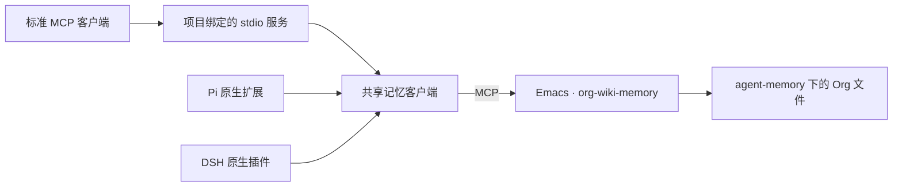

# Org-wiki 共享记忆设计

Pi、DeepSeek Harness（DSH）及其他 MCP 客户端可以直接读写同一份 Org 记忆。**固定项目优先使用标准 MCP；需要首轮自动召回，或一个宿主同时服务多个工作区时，使用原生插件。** 两种入口共用工具和存储，切换时已有记忆和引用 ID 继续有效。

## 接入方式

| 设计问题 | 标准 MCP | Pi / DSH 原生插件 |
| --- | --- | --- |
| 谁决定何时召回？ | Agent 按需调用搜索工具。项目指令可以提示它在依赖历史决定时先查记忆。 | 宿主在首个用户问题进入模型前检索，后续仍可按需调用工具。 |
| 项目从哪里来？ | stdio 服务启动时绑定一个工作区。建议显式传入项目路径。 | 每次调用从当前会话读取工作区，适合 DSH Web 同时打开多个项目。 |
| 写入怎样记录来源？ | 记录为 `mcp`，会话标识由 stdio 服务进程生成。 | 记录为 `pi` 或 `dsh`，保留宿主会话 ID。 |

例如，在项目 A 用 Pi 保存“提交前运行 `make check`”。绑定到 A 的 DSH MCP 客户端可以在新会话中搜索并读取这条决定；启用 DSH 原生插件后，首轮问“这个项目怎么验收？”就会触发检索。若 DSH Web 的多个会话共用绑定到 A 的 stdio 服务，它们都会使用 A 的项目范围。独立的项目服务或按会话取路径的原生插件都能解决这个问题。

## 从工具调用到 Org 文件

面向模型的接口有五个工具：`org_memory_remember`、`org_memory_search`、`org_memory_read`、`org_memory_update`、`org_memory_forget`。共享客户端补入项目、来源和请求标识，通过 Emacs 的专用 MCP 服务调用内部入口 `org_memory_dispatch`。普通 wiki 的 `wiki_search`、`wiki_read_node` 等工具面向整个 wiki 语料。按项目提供长期记忆时，只向该客户端注册一组 `org_memory_*` 工具。[stdio 入口](../packages/client/stdio.js) · [共享客户端](../packages/client/index.js) · [Emacs 后端](../org-wiki-memory.el)

## 存储、召回与纠正

- **存储范围。** 每条记忆是一个带稳定 Org ID 和 `WIKI_KIND: Memory` 的文件。项目记忆位于 `org-wiki-root/agent-memory/<项目键>/`，可跨项目使用的个人记忆位于同级 `personal/`。项目键取自规范化路径的哈希；同一 Git 仓库的多个 worktree 共用 Git 公共目录，普通目录各自独立。搜索和按 ID 操作都限定在当前项目与个人目录。
- **召回。** 搜索直接读取已保存的文件，标题和摘要的匹配权重高于正文，支持中文相邻字对。写入后另一端即可检索，无需等待 qmd 同步。Pi 的 `before_agent_start` 和 DSH 的 `agent/pre-step` 复用同一搜索逻辑，每次首轮最多注入 5 条摘要，共 2,000 个 UTF-16 代码单元，并附 Org ID 供读取正文。[Pi 扩展](../packages/pi/index.ts) · [DSH 插件](../packages/dsh/index.js)
- **并发修改。** 读取结果带内容版本。纠正和遗忘都要提交 `expected_revision`。若用户已在 Emacs 保存了新内容，旧版本会触发冲突，调用方应重读后再修改。未保存编辑也会阻止覆盖。后端在文件锁内原子替换文件，纠正时保留原始来源并记录最后编辑者。
- **遗忘与故障。** 遗忘会用操作指纹替换记录内容，后续搜索和按 ID 读取都无法取回正文。此前注入宿主会话的摘要和用户备份按各自的保留策略处理。Emacs 离线时，原生插件跳过首轮摘要，显式工具调用返回错误；后续调用会重新连接。

## 实现验证

ERT 测试覆盖项目隔离、个人共享、版本冲突、未保存编辑和遗忘。跨宿主测试在临时 Emacs 中执行 Pi 写入、DSH 召回并纠正、Pi 读回新值，并检查另一个项目按原 ID 读取时得到 `unknown_id`。安装命令、软件包调研与工具参数见接入指南。[后端测试](../org-wiki-memory-test.el) · [跨宿主测试](../tests/host.test.mjs) · [接入指南](agent-memory.md)
