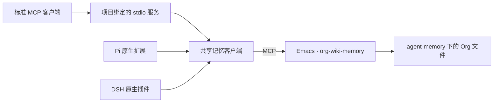

# Org-wiki 共享记忆设计

Pi、DeepSeek Harness（DSH）及其他 MCP 客户端可以直接读写同一份 Org 记忆。**固定项目优先使用标准 MCP；需要首轮自动召回，或一个宿主同时服务多个工作区时，使用原生插件。** 两种入口共用工具和存储，切换时已有记忆和引用 ID 继续有效。

## 接入方式

| 设计问题 | 标准 MCP | Pi / DSH 原生插件 |
| --- | --- | --- |
| 谁决定何时召回？ | Agent 按需调用搜索工具。项目指令可以提示它在依赖历史决定时先查记忆。 | 宿主在首个用户问题进入模型前检索，后续仍可按需调用工具。 |
| 项目从哪里来？ | stdio 服务启动时绑定一个工作区。建议显式传入项目路径。 | 每次调用从当前会话读取工作区，适合 DSH Web 同时打开多个项目。 |
| 写入怎样记录来源？ | 记录为 `mcp`，会话标识由 stdio 服务进程生成。 | 记录为 `pi` 或 `dsh`，保留宿主会话 ID。 |

例如，在项目 A 用 Pi 保存“提交前运行 `make check`”。绑定到 A 的 DSH MCP 客户端可以在新会话中搜索并读取这条决定；启用 DSH 原生插件后，首轮问“这个项目怎么验收？”就会触发检索。若 DSH Web 的多个会话共用绑定到 A 的 stdio 服务，它们都会使用 A 的项目范围。独立的项目服务或按会话取路径的原生插件都能解决这个问题。

## 从工具调用到 Org 文件

面向模型的接口有五个工具：`org_memory_remember`、`org_memory_search`、`org_memory_read`、`org_memory_update`、`org_memory_forget`。共享客户端补入项目、来源和请求标识，通过 Emacs 的专用 MCP 服务调用内部入口 `org_memory_dispatch`。普通 wiki 的 `wiki_search`、`wiki_read_node` 等工具面向整个 wiki 语料。按项目提供长期记忆时，只向该客户端注册一组 `org_memory_*` 工具。[stdio 入口](../packages/client/stdio.js) · [共享客户端](../packages/client/index.js) · [Emacs 后端](../org-wiki-memory.el)

## 存储、召回与纠正

- **存储范围。** 每条记忆有稳定的 Org ID。总结直接以 `WIKI_KIND` 标记为道、法或术，原始观察使用 `Memory`。项目记忆位于 `org-wiki-root/agent-memory/<项目键>/`，可跨项目使用的个人记忆位于同级 `personal/`。项目键取自规范化路径的哈希，同一 Git 仓库的多个 worktree 共用 Git 公共目录，普通目录各自独立。搜索和按 ID 操作都限定在当前项目与个人目录。
- **文件名。** 新记忆使用 `YYYYMMDDTHHMMSSZ-<12 位哈希>-<ID 后缀>.org`。时间戳为 UTC，短哈希包含记忆内容、会话和请求标识，以区分同一秒内的独立写入。重试和更新沿用已有文件名，旧格式 `<Org ID>.org` 也可以继续使用。
- **召回。** Emacs 统一选择检索后端。启用 qmd 后，记忆搜索与普通 Wiki 搜索共用索引和后端设置。Emacs 只接受当前项目及个人目录中的记忆，验证原始 Org 记录后按 qmd 排名返回。qmd 关闭、失败或没有可用结果时，Emacs 在同一范围内做文字匹配。Pi 的 `before_agent_start` 和 DSH 的 `agent/pre-step` 调用同一搜索接口，每次首轮最多注入 5 条摘要，共 2,000 个 UTF-16 代码单元，并附 Org ID 供读取正文。[Pi 扩展](../packages/pi/index.ts) · [DSH 插件](../packages/dsh/index.js)
- **并发修改。** 读取结果带内容版本。纠正和遗忘都要提交 `expected_revision`。若用户已在 Emacs 保存了新内容，旧版本会触发冲突，调用方应重读后再修改。未保存编辑也会阻止覆盖。后端在文件锁内原子替换文件，纠正时保留原始来源并记录最后编辑者。
- **遗忘与故障。** 遗忘会用包含遗忘操作指纹和创建键的标记替换记录内容，后续搜索和按 ID 读取都无法取回正文。此前注入宿主会话的摘要和用户备份按各自的保留策略处理。Emacs 离线时，原生插件跳过首轮摘要，显式工具调用返回错误。后续调用会重新连接。

### 由 Org 生成记忆文件 ID

`org_memory_remember` 在首次创建时让 Emacs 生成文件级 `:ID:`。工具返回的 `id` 和指向该记忆的 `[[id:…]]` 使用这个值。文件头另存 `MEMORY_CREATE_KEY`，用于识别同一创建请求。[写入实现](../org-wiki-memory.el)

1. **生成和登记。** Emacs 在准备写入的 Org 缓冲区移到文件开头，调用 `(org-id-get-create)`。该函数遵循 `org-id-method` 和 `org-id-prefix`，默认生成 UUID。文件原子写入成功后，Emacs 才向 Org 登记最终路径，并在 Org-roam 索引可用时刷新反链。修订沿用原 ID。[Org 函数定义](https://github.com/bzg/org-mode/blob/main/lisp/org-id.el)
2. **识别重试。** Emacs 用项目、范围、宿主、会话和请求标识计算创建键，先按键加锁，再在目标目录查找已有记录或遗忘标记。当前版本仍对应原请求时，重试直接返回已保存的 ID 和版本。同一个创建键提交了不同内容，或原记录已经修订时，返回 `request_conflict`。已遗忘的记忆返回 `unknown_id`。修订保留创建键，遗忘标记同时保留创建键和遗忘操作指纹。
3. **处理 ID 碰撞。** 新建时，Emacs 按生成的 ID 加锁，在各记忆目录中检查文件名，并核对 Org 或 Org-roam 已登记的节点。若 ID 已被占用，返回 `id_conflict`。这也适用于两个项目同时使用只精确到秒的自定义时间戳。锁正被占用时，重试方会收到 `busy`。
4. **确定文件名。** UUID 直接用作后缀。后端也保留可直接用于文件名的自定义 ID。对于包含路径分隔符等特殊字符或超过 200 字节的 ID，文件名使用 `!` 加该 ID 的 SHA-256，文件内和链接中仍使用完整的 Org ID。读取、更新和遗忘按 ID 在当前项目和个人目录内核对记录。

早期版本使用 `mem-` 加创建键作为公开 ID。读取和重试仍识别带时间戳和只含 ID 的两种旧文件名，以及仅含操作指纹的旧遗忘标记。修订旧记录会保留原 ID 和文件名，原链接可以继续打开。

## 写入时的节点匹配

`org_memory_remember` 和 `org_memory_update` 按记忆中实际出现的名称或 ID 建立链接。例如，“弃用 SQLite”会连到 SQLite，摘录中的“弃用”说明了两者的关系。匹配独立于 qmd 的召回设置。Emacs 依次拼接 `title`、`summary`、`body`，从本地 Org-roam 数据库的 `nodes` 和 `aliases` 表读取 ID、文件路径、标题和别名，然后按以下规则处理。

1. **识别显式 ID。** Emacs 记下每个 `id:` 链接的目标和第一次出现的位置，然后在用于名称匹配的文本中用等长空格遮住所有 Org 链接。如果输入是 `[[id:missing][SQLite]]`，失效的 ID 和它的显示文字会一起跳过。
2. **查找标题和别名。** 至少两个字符的标题或 `ROAM_ALIASES` 别名才参与名称匹配。匹配要求名称的字符连续出现，忽略大小写。连续的 ASCII 字母、数字和下划线视为一个标识符，所以“使用sqlite验证”可以命中 `SQLite`，而 `NoSQL`、`SQLite` 和 `SQL_plan` 中的 `SQL` 都会被跳过。
3. **限定可见范围。** Emacs 按文件的真实路径筛选目标。项目记忆可链接普通 Org-roam 笔记、本项目记忆和个人记忆。个人记忆可链接普通笔记和个人记忆。两种范围都会跳过自引用。
4. **核对源文件。** Emacs 在已保存的本地文件中定位 `:ID:`，确认条目仍符合 Org-roam 的收录条件。按名称命中时还要核对文件里的标题或别名，因此旧名和已删除的节点会被过滤。旧格式文件若以文件 ID 代指首个 Wiki 标题，则使用该标题在同一文件中已索引的规范 ID。
5. **消歧、排序并限制数量。** 在通过核对的候选中，一个名称必须唯一对应一个规范 ID。同一起点有长短两个名称时先匹配较长的名称。显式 ID 按首次出现的位置排在前面，其余名称按在标题、摘要、正文中的出现顺序排列。最后按规范 ID 去重，再应用 `org-wiki-memory-max-links` 的上限。同一目标既有显式链接又有别名命中时，保留显式链接所在处的摘录。

每个保留目标在记忆文件的 `* Relations` 下占一个列表项，格式为 `[[id:规范ID][目标标题]]`。下一行以 Org 固定宽度文本保存原文片段。摘录从命中起点向前最多取 120 个字符，从起点向后最多取 160 个字符，遇到换行或中英文句号、问号、叹号即截断。健康检查通过 Org-roam 和目标文件核对普通笔记的链接。核对 `SOURCE_IDS` 时，只统计生成列表以外的来源引用。[匹配与写入实现](../org-wiki-memory.el) · [健康检查](../org-wiki-health.el) · [输入与保存结果示例](agent-memory.md#写入时关联-org-roam-节点)

### 更新、遗忘与索引故障

关系和记忆正文在同一次原子写入中保存。只要记忆文件属于 Org-roam 的索引范围且数据库可用，写入后 Emacs 就调用 `org-roam-db-update-file` 刷新该文件。共享客户端给新建、更新和搜索的 MCP 调用各留出 60 秒，读取和遗忘的调用超时为 5 秒。[共享客户端](../packages/client/index.js)

| 情况 | 文件和反链的结果 |
| --- | --- |
| 更新内容，候选检索成功 | 用新匹配替换 `* Relations`。刷新索引后，被删去的链接也从目标的反链中消失。零命中时省略该段，`related_ids` 返回 `[]`。 |
| 已启用匹配，但候选索引不可用或查询失败 | 新记忆仍可保存，`related_ids` 为 `[]`。修订已有记忆时保留原关系，等索引可用后再次更新才按新文本匹配。 |
| 文件已保存，反链索引刷新失败 | 已保存的链接和内容版本仍可读取。重放同一写入请求会复用已有记录，并重试刷新索引。 |
| 遗忘记忆 | 文件内容替换为遗忘操作指纹和创建键。索引刷新后，从该记忆出发的链接及对应反链一并移除。 |

## 实现验证

ERT 测试在临时库中验证 UUID 与自定义时间戳、长 ID 和文件名编码、请求重试、跨项目 ID 碰撞、写入失败后的重试，以及修订后打开旧链接。测试也覆盖项目隔离、个人共享、版本冲突、未保存编辑和遗忘。自动建链用临时 Org-roam 数据库验证显式 ID 与别名的顺序、同名消歧、过期索引、旧文件 ID、离线保留关系和反链刷新重试。[后端测试](../org-wiki-memory-test.el)

跨宿主测试在临时 Emacs 中让 Pi 保存含 `make check` 的记忆，断言它命中以该命令为别名的节点，再用 DSH 读回同一组 `related_ids`。测试也覆盖 DSH 召回并纠正、Pi 读回新值，以及另一个项目按原 ID 读取时得到 `unknown_id`。[跨宿主测试](../tests/host.test.mjs) · [接入指南与验证命令](agent-memory.md#验证与回退)
